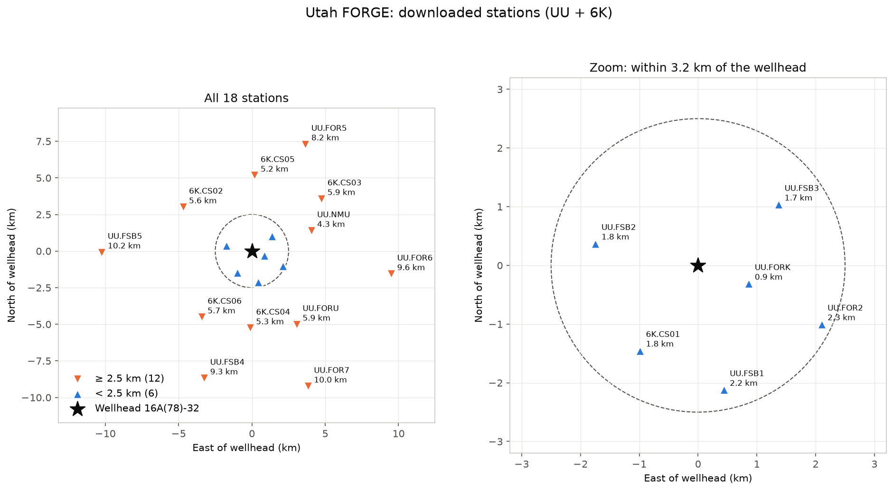

# Double-difference relocation of Utah FORGE 2024 stimulation seismicity

Relocating the induced microseismicity of the April 2024 hydraulic stimulations at
[Utah FORGE](https://utahforge.com/) with **hypoDD** and **GrowClust3D**, using only public data
and a pipeline written step by step in Python (ObsPy, SeisBench, NumPy/SciPy, pandas).

The goal is to rebuild the full relocation workflow independently: download the waveforms, pick
phases with a machine-learning picker, compute catalog and waveform cross-correlation differential
times, and relocate. The published catalog of Niemz et al. (2025) serves as the benchmark.

> **Status: work in progress.** Data download, PhaseNet picking and a first catalog-only hypoDD
> run are done. Waveform cross-correlation (`dt.cc`) and GrowClust are next. See
> [Status and results](#status-and-results).

---

## Why this project

Utah FORGE is a field-scale laboratory for Enhanced Geothermal Systems (EGS). In April 2024,
well 16A(78)-32 was stimulated in several stages, and the injection produced thousands of small
earthquakes (M −1 to 2). Where those events sit, and how they line up, shows which fractures took
fluid. Relative relocation with double-difference methods turns a diffuse cloud of hypocentres into
sharp fracture zones, so it is a core step in EGS monitoring.

## Data (all public)

| Data | Source | Used for |
|---|---|---|
| Microseismic catalog, 2,900 events, Apr 3–15 2024 (Niemz et al., 2025) | [Zenodo 12817881](https://zenodo.org/records/12817881) | Starting locations, origin times, benchmark |
| Continuous waveforms, UU permanent FORGE stations (12) | EarthScope FDSN, network UU | Picking, cross-correlation |
| Continuous waveforms, Fervo Cape Modern network (6 stations, 1000 Hz) | EarthScope FDSN, network 6K | Picking, cross-correlation |
| Composite 3D FORGE velocity model (Finger et al., 2024) | [GDR 1585](https://doi.org/10.15121/2305384) | Travel times, 1D layered model |

The catalog itself was built with 16 stacked nodal-geophone patches (network 5K), but those
waveforms are restricted (EarthScope MDA 24-037). This project uses only the public UU and 6K
stations, so the station geometry is sparser than in the original study. The comparison with the
published catalog shows how much that costs.



*The 18 public stations and the wellhead of 16A(78)-32 (origin of the local coordinate system).*

## Workflow

```
 Zenodo catalog ─┐
 FDSN waveforms ─┼─► 1. download ─► 2. PhaseNet picks ─► 3. associate ─► phase.dat
 StationXML ─────┘                                                          │
                                                                            ▼
                                   station.dat ───────────────────────► 4. ph2dt ─► dt.ct
                                                                            │
                     5. waveform cross-correlation (ObsPy) ─► dt.cc ────────┤
                                                                            ▼
                                                     6. hypoDD   7. GrowClust3D
                                                                            │
                                                                            ▼
                                                  8. compare with Niemz et al. (2025)
```

1. **Download** the catalog, StationXML and event-windowed waveforms (−5 to +15 s around each
   origin) for 18 stations within 0.1° of the wellhead.
2. **Pick P and S** with PhaseNet (SeisBench, pretrained `ethz` weights, the same model Niemz et al.
   used inside qseek). The catalog has no phase picks, so this step is needed.
3. **Associate** picks with each catalog event (time window after origin, one P and one S per
   station, minimum picks per event) and write hypoDD `phase.dat`. Pick weight = PhaseNet
   probability.
4. **ph2dt** builds catalog differential times (`dt.ct`) for neighbouring event pairs.
5. **Cross-correlation differential times** (`dt.cc`) with my own ObsPy code: 20–40 Hz band-pass,
   short windows (−0.05 to +0.35 s) around the picks, upsampling for sub-sample lags, P on the
   vertical and S on the horizontals, CC > 0.7. *(next step)*
6. **hypoDD:** first catalog-only, then catalog + cross-correlation.
7. **GrowClust3D.jl** with the same cross-correlation data, including bootstrap uncertainties.
8. **Compare** catalog, hypoDD and GrowClust in map view and cross sections along and across the
   well, and interpret the fracture geometry.

Every parameter choice and the reasoning behind it is recorded in [notes/](notes/).

## Status and results

| Step | Status |
|---|---|
| Download data (catalog, StationXML, 2,900 event waveforms, velocity model) | ✅ |
| Station file with checked sensor elevations | ✅ |
| PhaseNet picking, all events | ✅ |
| `phase.dat` + ph2dt + hypoDD, catalog-only (Milestone 1) | ✅ first run |
| Waveform cross-correlation → `dt.cc` | ⬜ next |
| hypoDD with `dt.ct` + `dt.cc` | ⬜ |
| GrowClust3D with bootstrap uncertainties | ⬜ |
| Comparison and interpretation | ⬜ |

**Run 1, catalog-only hypoDD** ([notes/HypoDD_run1.md](notes/HypoDD_run1.md)):
1,388 events relocated from 85,650 catalog differential times. The relocated cloud is about
**twice as diffuse** as the published catalog. That is the expected outcome rather than a failure:
the starting catalog is already a cross-correlation relocation with ~10 m relative errors, and
PhaseNet picks have residuals of ~46 ms (≈ 150–250 m). Catalog picks alone cannot sharpen a
catalog that is already sharp, so the improvement has to come from waveform cross-correlation.
The run also showed two problems to fix first: events lost as "air-quakes" because of the
sea-level datum, and over-damping.

## Repository layout

```
forge_relocation/
├── scripts/py/
│   ├── 01_download_data.py      # catalog, StationXML, event waveforms (FDSN)
│   ├── 02_run_phasenet.py       # PhaseNet on all events → raw picks CSV
│   ├── create_station_dat.py    # station.dat with sensor elevations checked against a DEM
│   ├── phase_pick.py            # pre-processing, parallel picking, phase.dat writer
│   ├── HypoDD.py                # write ph2dt.inp / hypoDD.inp, run them, read results
│   ├── plots.py                 # pick browser, catalog vs. relocation maps and sections
│   └── plot_stations.py         # station map
├── notebooks/                   # exploration: waveforms, picking, hypoDD runs
├── notes/                       # method notes, parameter choices, run logs, INSTALL.md
├── figures/
└── data/                        # raw data and run files (not in git, rebuilt by the scripts)
```

## Getting started

**Software:** Linux, Python 3 (ObsPy, SeisBench, NumPy/SciPy, pandas, matplotlib), gfortran for
hypoDD, Julia for GrowClust3D.jl. Compiling hypoDD and installing GrowClust3D.jl is described step
by step in [notes/INSTALL.md](notes/INSTALL.md).

```bash
# Python environment
python -m venv .loc
source .loc/bin/activate
pip install obspy numpy scipy pandas matplotlib jupyterlab ipykernel tqdm pyproj cartopy seisbench

# Data (~3 GB of waveforms for the whole catalog)
python scripts/py/01_download_data.py
python scripts/py/create_station_dat.py
python scripts/py/plot_stations.py

# Picking (about 15 min on a 12-core CPU)
python scripts/py/02_run_phasenet.py
```

The association, ph2dt and hypoDD steps are run from `notebooks/hypoDD.ipynb` through the
functions in `scripts/py/phase_pick.py` and `scripts/py/HypoDD.py`.

## Coordinates and datum

- Local system centred on the wellhead of 16A(78)-32 (38.50402147° N, 112.8963897° W, 1650 m),
  the same as the catalog and the 3D velocity model.
- Catalog depths are below the wellhead. hypoDD run 1 uses sea level as its datum
  (depth − 1.65 km), with station elevations in metres above sea level.
- In the published catalog, the lat/lon and east/north columns are offset by a constant
  (≈ 174 m E, 95 m S). Relative positions are unaffected; one set is used consistently.

## References

- Niemz, P., Pankow, K., Isken, M. P., Whidden, K., McLennan, J., & Moore, J. (2025). Mapping
  fracture zones with nodal geophone patches: Insights from induced microseismicity during the 2024
  stimulations at Utah FORGE. *Seismological Research Letters*, 96(3), 1603–1618.
  https://doi.org/10.1785/0220240300
- Niemz, P., Petersen, G., Rutledge, J., Whidden, K., & Pankow, K. (2026). Isotropic components of
  microseismic moment tensors at Utah FORGE reveal a diversity of fluid pathway creation processes
  in EGS development. *Scientific Reports*, 16, 12916. https://doi.org/10.1038/s41598-026-42493-0
- Asirifi, R., Chen, X., Mohammadi, A., Nakata, N., & Ratre, P. (2026). Sequential fracture
  activation and stress evolution during EGS stimulation at Utah FORGE revealed by waveform
  cross-correlation. *JGR: Solid Earth*, 131, e2025JB033044. https://doi.org/10.1029/2025JB033044
- Finger, C., Niemz, P., Ermert, L., & Lanza, F. (2024). Utah FORGE: Composite 3D seismic velocity
  model. Geothermal Data Repository. https://doi.org/10.15121/2305384
- Waldhauser, F., & Ellsworth, W. L. (2000). A double-difference earthquake location algorithm:
  Method and application to the northern Hayward fault, California. *BSSA*, 90(6), 1353–1368.
- Trugman, D. T., & Shearer, P. M. (2017). GrowClust: A hierarchical clustering algorithm for
  relative earthquake relocation. *Seismological Research Letters*, 88(2A), 379–391.
- Zhu, W., & Beroza, G. C. (2019). PhaseNet: A deep-neural-network-based seismic arrival-time
  picking method. *Geophysical Journal International*, 216(1), 261–273.
- Woollam, J., et al. (2022). SeisBench: A toolbox for machine learning in seismology.
  *Seismological Research Letters*, 93(3), 1695–1709.
- Beyreuther, M., et al. (2010). ObsPy: A Python toolbox for seismology. *SRL*, 81(3), 530–533.

## Author

Edith Sotelo
